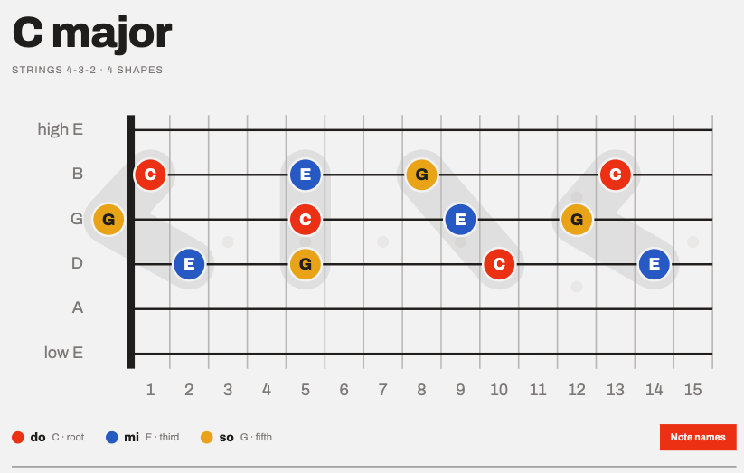

# Triad Trainer



Guitar triad reference. Pick a key, a quality and a string set, and it shows
every shape of that triad on the neck at once, from the nut to the fifteenth
fret.

## Learning

Each dot is coloured by its job in the chord: red is do (the root), marigold
is mi (the third) and blue is so (the fifth). The three tiles at the top give
that chord's notes for each. Minor chords use the same three names, so a minor
triad looks like its major one with the marigold dot a fret lower. The dot
itself shows the note name, and "Note names" in the bottom bar hides it when
you want to test yourself.

A sand-coloured band ties each shape's three notes together. Inversions repeat
an octave up, so most string sets show three to five shapes. On a phone the
neck stands upright, nut at the top and low E on the left, like a chord chart.

The bottom bar holds a metronome, three clicks to a bar. Each click lights do,
mi and so in turn and lifts the matching tile. It does not change the picture.
Play through the shapes at whatever pace suits.

## Comping

Switch to **Comping** at the top, then pick a progression, a key, a string set
and a sound. Press Start and you get one bar of clicks, then the progression on
piano or guitar, round and round. Bass on one and three, chord on two and four,
all of it below middle C so it sits under what you play.

The fretboard shows every shape of the chord that is sounding, coloured the
same way as in learning mode, with the same three tiles above it. Pick
whichever shape is nearest your hand. The row of chord names above the neck
shows what is coming.

The sounds are real samples, fetched the first time you press Start, so that
first time needs an internet connection.

## Running it

Once, to install:

```sh
cd backend  && uv sync
cd frontend && npm install
```

Then, to run:

```sh
./scripts/dev.sh
```

Open <http://localhost:5173>. Ctrl-C stops both halves.

## Where it runs

It lives on the house Raspberry Pi, not on a laptop, at
`https://triads.julianjelfs.co.uk`. Anyone on the home wifi can open it with
nothing installed. One systemd unit runs uvicorn on loopback; Caddy in front of it
holds the certificate and is the only thing listening on the network.

Drive it from the laptop with `triad-trainer`, which works over SSH:

```sh
triad-trainer            # open it
triad-trainer status     # app, Caddy, backups, temperature
triad-trainer rebuild    # after changing code
triad-trainer logs
triad-trainer backup     # snapshot now and pull it here
```

`triad-trainer rebuild` pulls the code on the Pi and syncs dependencies there,
builds the frontend **here**, and copies the result across. The Pi never runs
Vite, which is what keeps a 2GB board comfortable.

Away from the house it is on the tailnet at
`https://pi.tail50bfbf.ts.net:8443`, and `triad-trainer url` picks whichever
applies.

To set a Pi up from scratch, or to put the units back after changing them, run
`./deploy/install-pi.sh` on the Pi. It is safe to re-run and never touches the
database. Caddy is configured from the recipe-for-disaster repo, because one
Caddyfile serves both apps.

Your settings live in `backend/triads.db` **on the Pi**. It is backed up there
nightly, keeping 14, and pulled to `~/Backups/triad-trainer` on the laptop,
keeping 30. The practice log from the old drill is still in that file,
untouched; nothing reads it any more.
